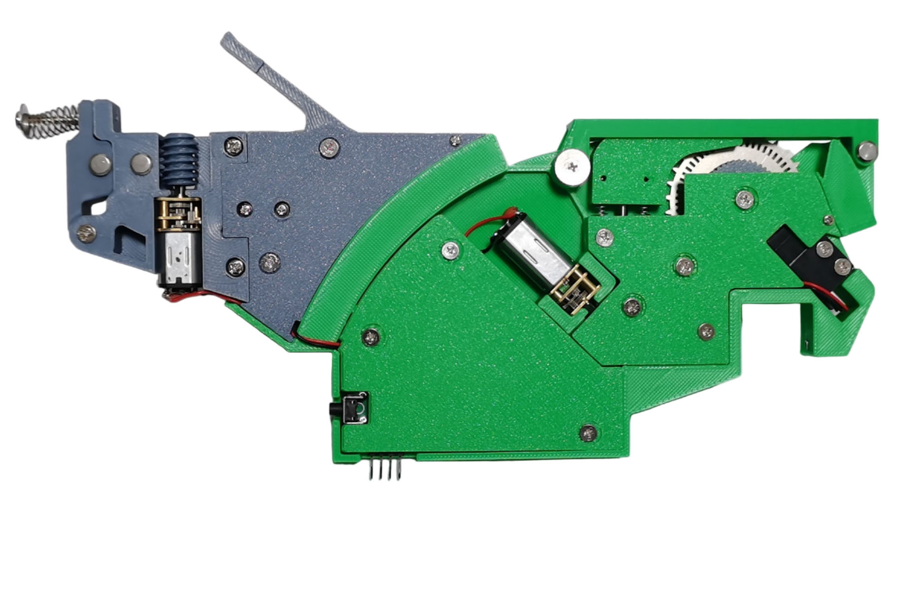
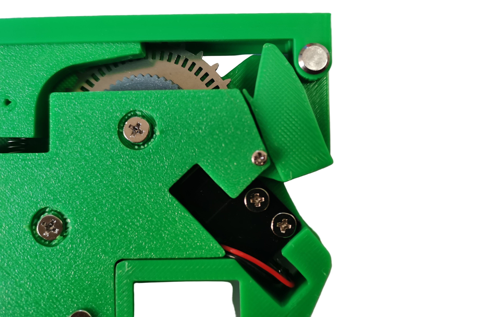
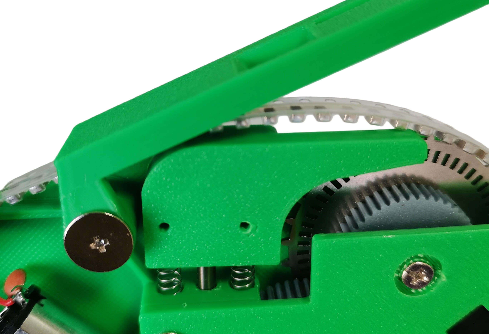
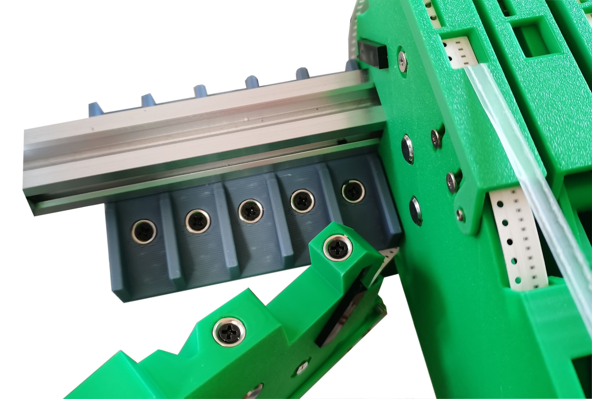

# Bing feeders and controllers

> **Original: [MicroSMT / Bing-feeder](https://github.com/microsmt/Bing-feeder).** [Credits and local changes](../CREDITS.md).

Browse the V3 and V485 collections: 3D parts, PCB previews, Gerber ZIPs, firmware and assembly references.

| Browse | Contents |
| --- | --- |
| [V485 feeder](V485-feeder/README.md) | 8/12/16/24 mm mechanics, shared parts, feeder/display PCBs and STM32 sources |
| [V485 controller](V485-Feeder%20Controller/README.md) | ESP32-C3 PlatformIO firmware, controller PCB and RS485 busbars |
| [V3 feeder](V3-feeder/README.md) | 8/12/16/24 mm parts, shared parts, STM32 sources and manuals |
| [V3 controller](V3-Feeder%20Controller/README.md) | Mega2560 sketch, controller board and feeder busbars |
| [STM32 build guide](STM32-BUILD.txt) | Combined V485 HAL/PlatformIO project and remaining legacy SPL build notes |
| [License](LICENSE) | Supplied upstream license |

## Vendor introduction and support

### Get the kits www.microsmt.com.cn
### Technical support  
https://discord.gg/qT7ZAAgspy \
https://groups.google.com/g/pnpv3-bing-feeder  
### What is Bing feeder?
The Bing feeder is a sprocket-driven feeder with closed-loop control. It was designed for the MicroSMT PNPv3,  it uses a simple high-level pulse trigger, so it can be directly controlled via OpenPnP’s ReferenceAutoFeeder. Therefore, it is suitable for all types of PNP machines.

### Feature 1
Uses a photoelectric sensor to detect the sprocket position, achieving closed-loop control. The repeat position will never change.

### Feature 2
Through the elastic pad at the bottom, it can automatically adapt to tapes of different thicknesses and suppress tape vibration, preventing components from jumping out.

### Feature 3
A magnetic feeder mounting system makes feeder replacement quick and easy.

