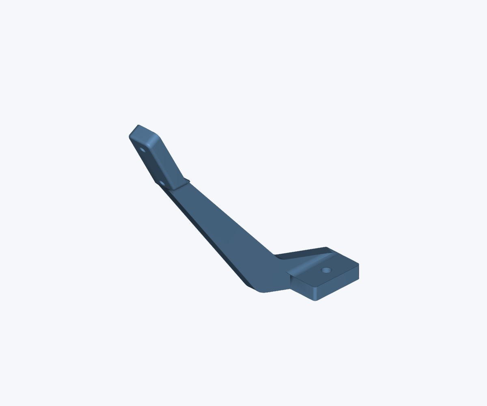
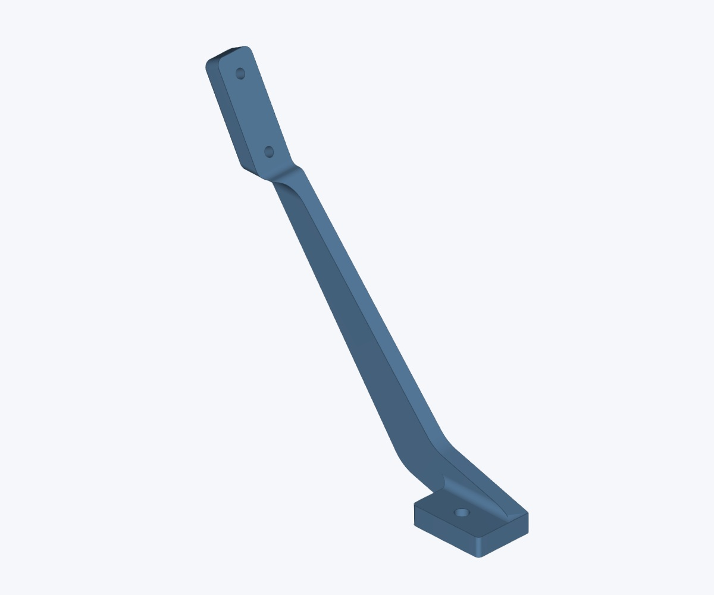
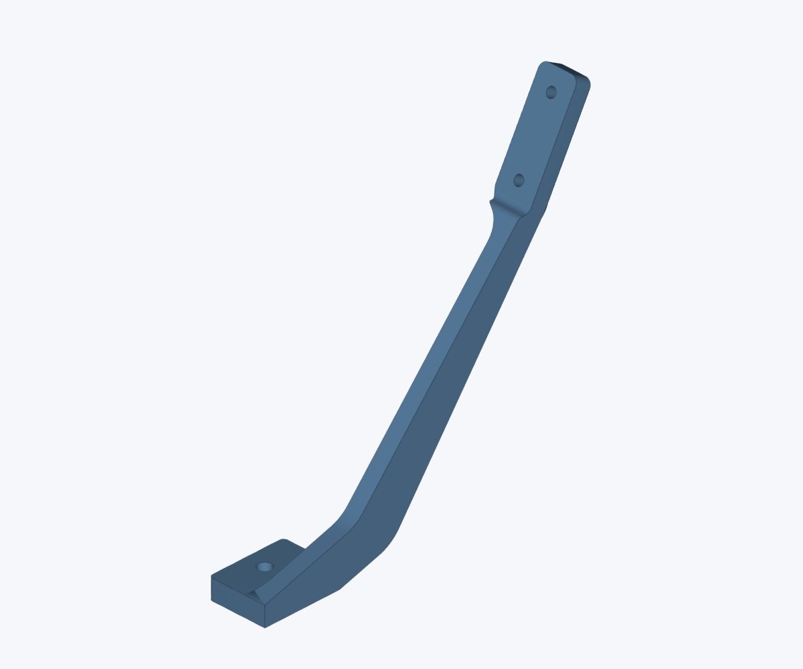
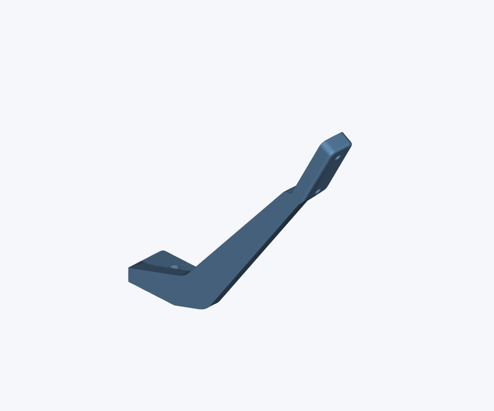
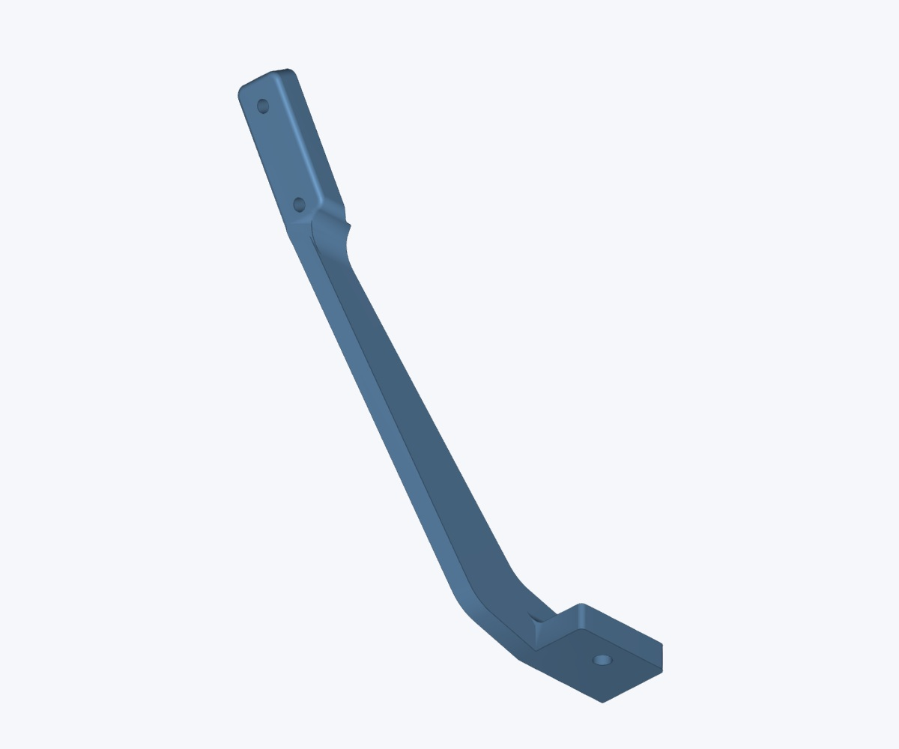
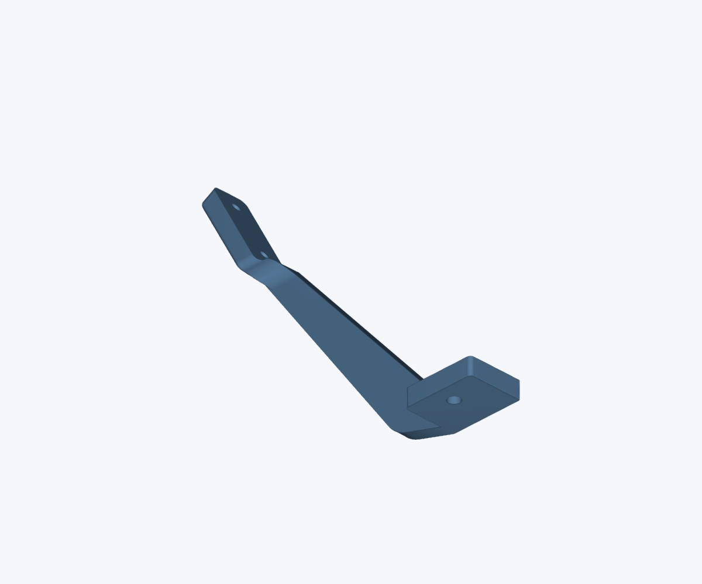
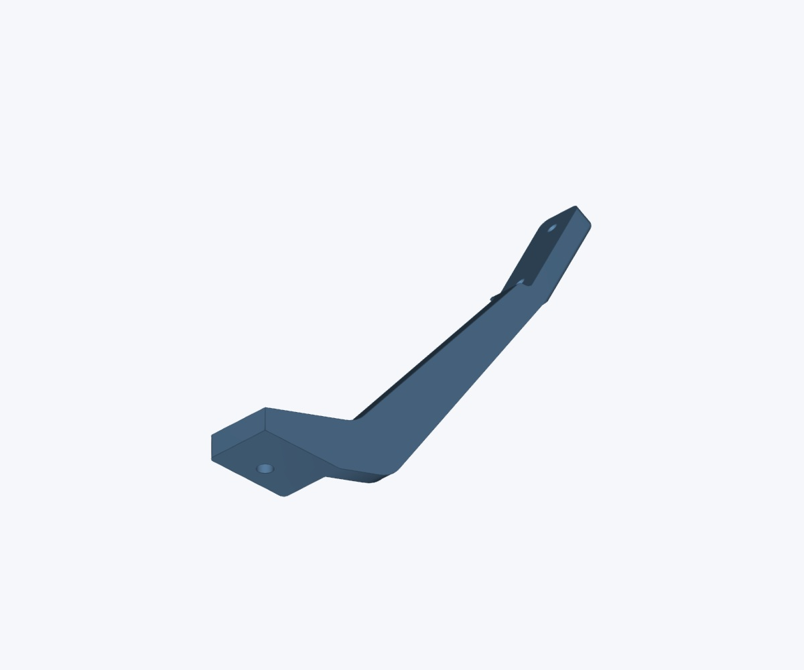
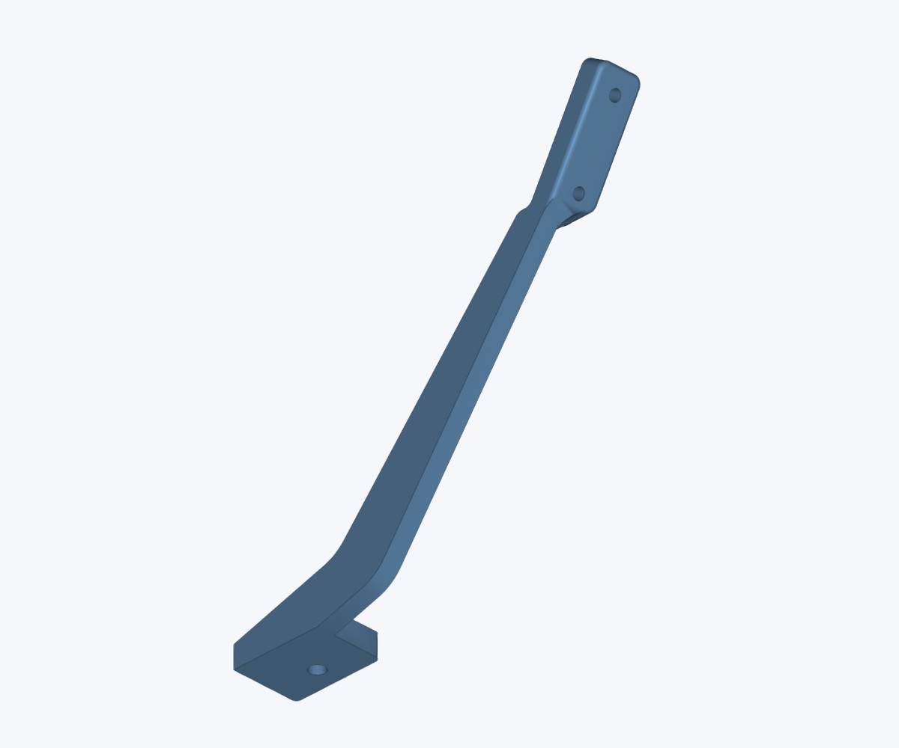

# V3 feeder controller parts

> Designs and original files by [MicroSMT](https://github.com/microsmt/Bing-feeder). [Credits and local changes](../../../CREDITS.md).

1 part · [All photos](photos/)

Click a picture to see it full size. **More views** shows the part from above and below.

## Busbar PCB hook

[STEP](V3_3D_busbar-pcb-hook.step) · [STL](V3_3D_busbar-pcb-hook.stl)

More views

<table>
<tr>
<td align="center"> Top 1</td>
<td align="center"> Top 2</td>
<td align="center"> Top 3</td>
<td align="center"> Top 4</td>
</tr>
<tr>
<td align="center"> Bottom 1</td>
<td align="center"> Bottom 2</td>
<td align="center"> Bottom 3</td>
<td align="center"> Bottom 4</td>
</tr>
</table>

