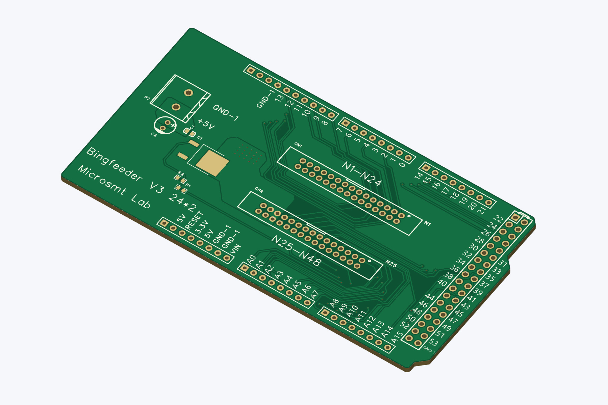
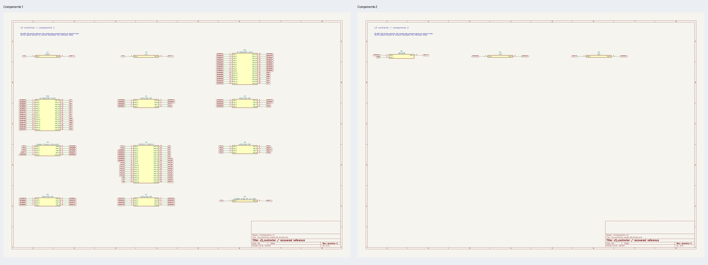
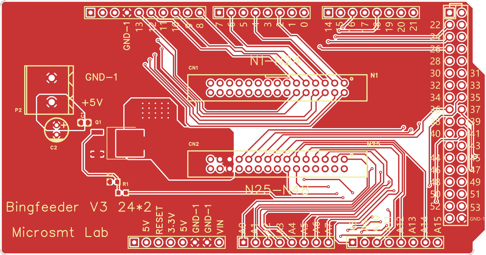
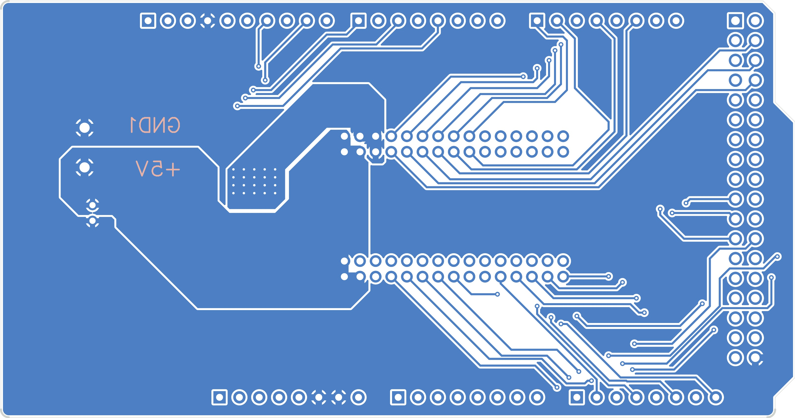

# V3 controller PCB

> **Original: [MicroSMT / Bing-feeder](https://github.com/microsmt/Bing-feeder).** [Credits and local changes](../../../CREDITS.md).

[Back to collection](../README.md)

Download the Gerber ZIP or click a preview to open it full size.

## Editable KiCad reference

Open these projects in **KiCad 10**. They are local reconstructions of MicroSMT’s manufacturing files, with connected schematics, native PCB objects and local libraries. Keep the whole `KiCad/` folder together.

The schematics preserve source pad numbers and nets using generic passive pin symbols. They establish connectivity; use the supplied schematic for device pin functions and electrical interpretation. Existing layout-rule findings remain visible.

| Project | Open in KiCad | Supporting reports |
| --- | --- | --- |
| V3 controller | [v3_controller.kicad_pro](KiCad/v3_controller.kicad_pro) | [Recovery](docs/recovery.json) · [Validation](docs/validation.json) |

[Recovery details](docs/KICAD_RECOVERY.md) · [Method and editing limits](../../../tools/kicad/RECOVERY_NOTES.md)

## Gerber previews — V3_controller_48_feeders_gerber

[Download Gerber ZIP](V3_controller_48_feeders_gerber.zip)

<table>
<tr>
<td align="center"> Top</td>
<td align="center"> Bottom</td>
<td align="center"> Top-side isometric</td>
</tr>
</table>

## Schematics, BOMs and supplied notes

- [V3_controller_48_feeders_schematic.png](photos/V3_controller_48_feeders_schematic.png)
- [V3_controller_BOM.xlsx](docs/V3_controller_BOM.xlsx)

The previews show bare-board geometry from the supplied Gerbers and drill files. Colours and the 1.6 mm rendering thickness are illustrative.

## KiCad previews

These JPGs show the recovered editable projects. The Gerber previews above show the original manufacturing files. Click an image for full size.

### V3 controller

<table>
<tr>
<td align="center"> Recovered schematic</td>
<td align="center"> Recovered PCB top</td>
<td align="center"> Recovered PCB bottom</td>
</tr>
</table>

[Sheet overview](photos/kicad-v3_controller-overview.jpg) · [Components 1](photos/kicad-v3_controller-sheet-01.jpg) · [Components 2](photos/kicad-v3_controller-sheet-02.jpg)
