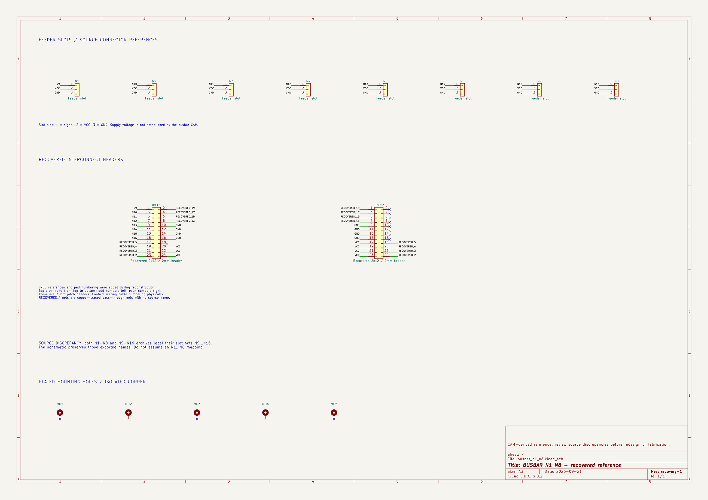
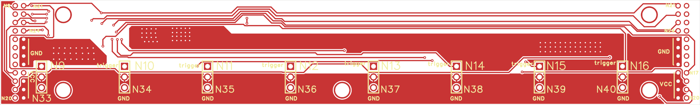
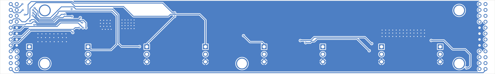

# V3 busbar — N1-N8

> Designs and original files by [MicroSMT](https://github.com/microsmt/Bing-feeder). [Credits and local changes](../../../CREDITS.md).

[Back to collection](../README.md)

Gerbers, editable KiCad files and previews are below.

## KiCad files

[Open project](KiCad/busbar_n1_n8.kicad_pro) · [Schematic](KiCad/busbar_n1_n8.kicad_sch) · [PCB](KiCad/busbar_n1_n8.kicad_pcb)

The downloads labelled N1–N8 and N9–N16 contain the same board layout, both with N9–N16 slot signals. Rebuilt from MicroSMT source files. Keep `KiCad/` together for its local libraries. Review the DRC results before editing or ordering.

[Components](docs/components.csv) · [Recovery data](docs/recovery.json) · [Validation](docs/validation.json) · [Mask/paste comparison](docs/mask-paste-comparison.json)

Read the [recovery notes](../../../tools/kicad/RECOVERY_NOTES.md) before layout changes or ordering boards. Paths in the recovery JSON start at the repository root.

## Original board views

[Download Gerber ZIP](V3_busbar_N1-N8_gerber.zip)

<table>
<tr>
<td align="center"> Top</td>
<td align="center"> Bottom</td>
<td align="center"> Top-side isometric</td>
</tr>
</table>

Gerber previews use display colours and an assumed 1.6 mm thickness; use source data for manufacturing dimensions.

## KiCad previews

KiCad reconstruction views; source Gerber views are above.

<table>
<tr>
<td align="center"> Recovered schematic</td>
<td align="center"> Recovered PCB top</td>
<td align="center"> Recovered PCB bottom</td>
</tr>
</table>
