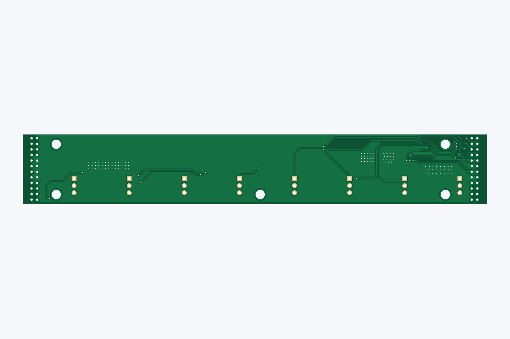
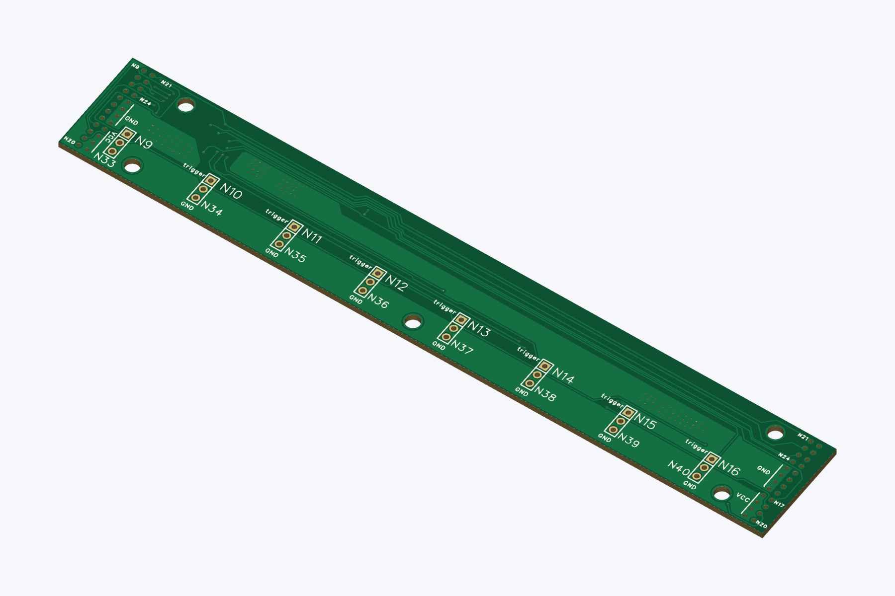

# V3 busbar — N1-N8

> **Original source: [MicroSMT / Bing-feeder](https://github.com/microsmt/Bing-feeder).** This is Gab's independently reorganised copy, prepared with help from ChatGPT. The original MicroSMT designs remain credited to their authors. [Credits and changes](../../../CREDITS.md).

[Back to collection](../README.md)

Download the Gerber ZIP or click a preview to open it full size.

## V3_busbar_N1-N8_gerber

[Download Gerber ZIP](V3_busbar_N1-N8_gerber.zip)

<table>
<tr>
<td align="center"> Top</td>
<td align="center"> Bottom</td>
<td align="center"> Top-side isometric</td>
</tr>
</table>

The previews show bare-board geometry from the supplied Gerbers and drill files. Colours and the 1.6 mm rendering thickness are illustrative.
