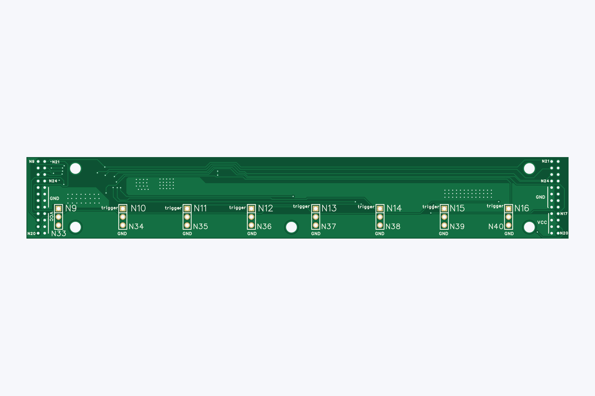
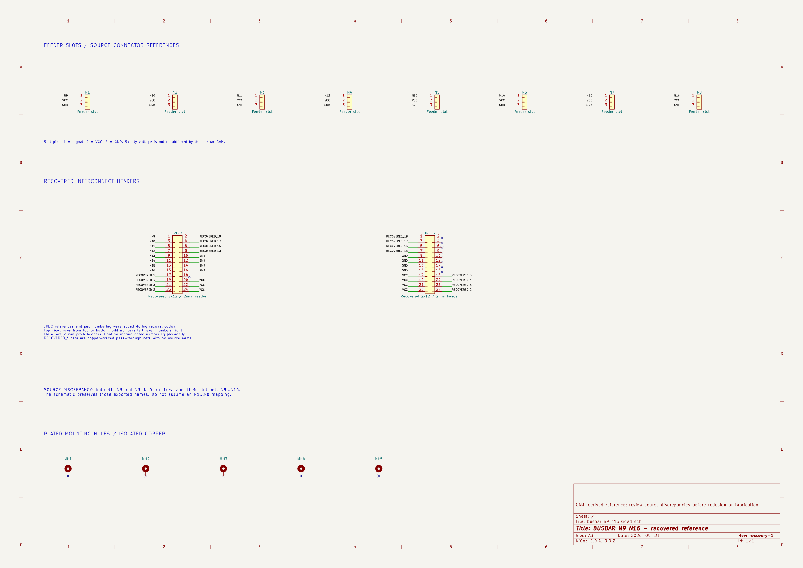
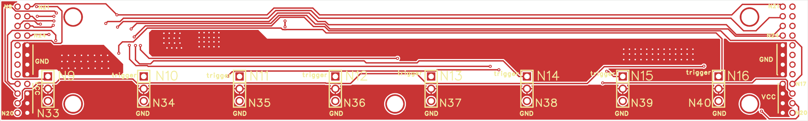
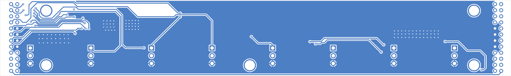

# V3 busbar — N9-N16

> **Original: [MicroSMT / Bing-feeder](https://github.com/microsmt/Bing-feeder).** [Credits and local changes](../../../CREDITS.md).

[Back to collection](../README.md)

Download the Gerber ZIP or click a preview to open it full size.

## Editable KiCad reference

[Open project](KiCad/busbar_n9_n16.kicad_pro) · [Schematic](KiCad/busbar_n9_n16.kicad_sch) · [PCB](KiCad/busbar_n9_n16.kicad_pcb)

The N1–N8 and N9–N16 archives contain identical geometry and N9–N16 slot nets. This is a local reconstruction from MicroSMT source files, with existing DRC findings. Keep the complete `KiCad/` folder together; its libraries are included in `KiCad/libraries/`.

[Components](docs/components.csv) · [Recovery data](docs/recovery.json) · [Validation](docs/validation.json) · [Mask/paste comparison](docs/mask-paste-comparison.json)

Read the [recovery notes](../../../tools/kicad/RECOVERY_NOTES.md) before layout changes or ordering boards. Paths recorded in the recovery JSON are relative to the repository root.

## Gerber previews — V3_busbar_N9-N16_gerber

[Download Gerber ZIP](V3_busbar_N9-N16_gerber.zip)

<table>
<tr>
<td align="center"> Top</td>
<td align="center"> Bottom</td>
<td align="center"> Top-side isometric</td>
</tr>
</table>

The previews show bare-board geometry from the supplied Gerbers and drill files. Colours and the 1.6 mm rendering thickness are illustrative.

## KiCad previews

These show the recovered editable project; the Gerber previews above show the supplied manufacturing files.

<table>
<tr>
<td align="center"> Recovered schematic</td>
<td align="center"> Recovered PCB top</td>
<td align="center"> Recovered PCB bottom</td>
</tr>
</table>
