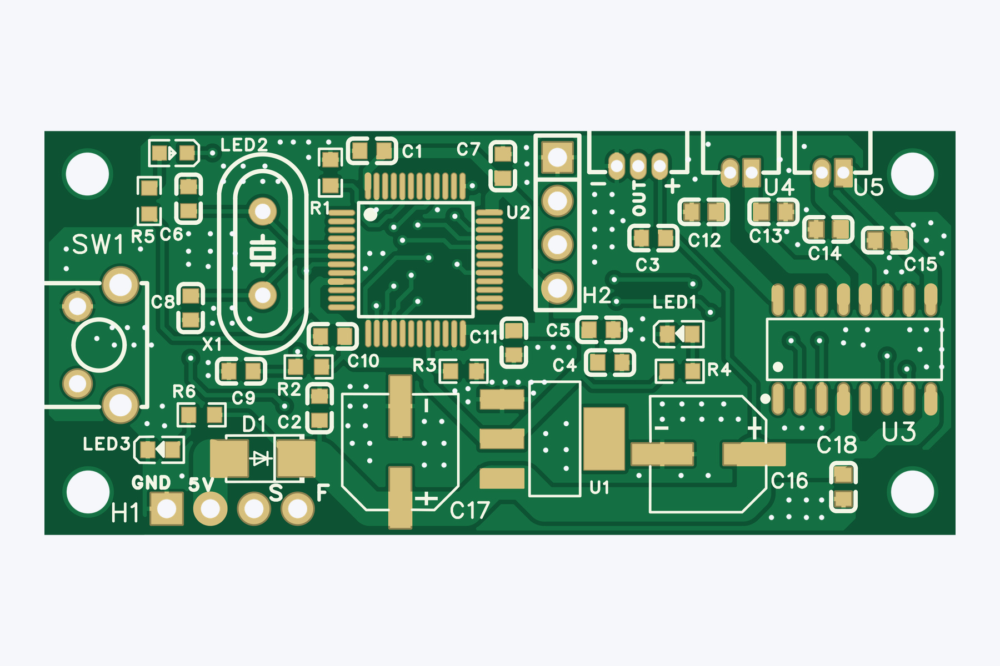
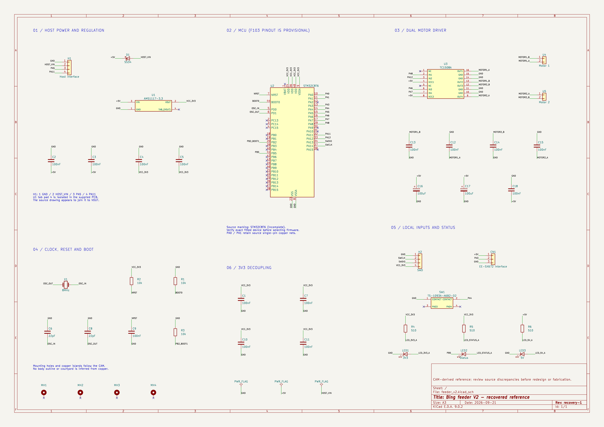
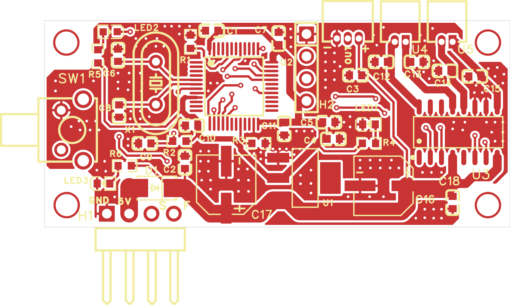
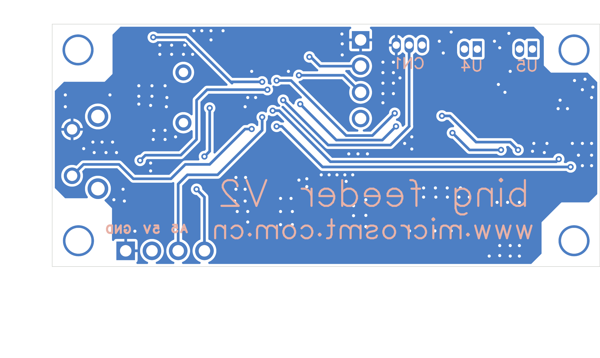

# V3 feeder PCB

> Designs and original files by [MicroSMT](https://github.com/microsmt/Bing-feeder). [Credits and local changes](../../../CREDITS.md).

[Back to collection](../README.md)

The Gerber ZIP, board previews and editable KiCad files are below. Click a picture for the full-size view.

## KiCad files

[Open project](KiCad/feeder_v2.kicad_pro) · [Schematic](KiCad/feeder_v2.kicad_sch) · [PCB](KiCad/feeder_v2.kicad_pcb)

The supplied schematic says V2, even though MicroSMT included it with the V3 files. These KiCad files were rebuilt from MicroSMT’s originals. DRC still reports layout issues. Keep the whole `KiCad/` folder together; it includes the libraries in `KiCad/libraries/`.

[Components](docs/components.csv) · [Recovery data](docs/recovery.json) · [Validation](docs/validation.json) · [Mask/paste comparison](docs/mask-paste-comparison.json)

Read the [recovery notes](../../../tools/kicad/RECOVERY_NOTES.md) before layout changes or ordering boards. Paths in the recovery JSON start at the repository root.

## Original board views

[Download Gerber ZIP](V3_feeder_gerber_2025-02-06.zip)

<table>
<tr>
<td align="center"> Top</td>
<td align="center"> Bottom</td>
<td align="center"> Top-side isometric</td>
</tr>
</table>

## Schematics, parts lists and notes

- [V3_feeder_schematic.png](photos/V3_feeder_schematic.png)

These pictures were drawn from the Gerbers and drill files. The colours and 1.6 mm board thickness are just display settings, not confirmed manufacturing specifications.

## KiCad previews

These views show the rebuilt KiCad project. The Gerber views above come from MicroSMT’s original files.

<table>
<tr>
<td align="center"> Recovered schematic</td>
<td align="center"> Recovered PCB top</td>
<td align="center"> Recovered PCB bottom</td>
</tr>
</table>
