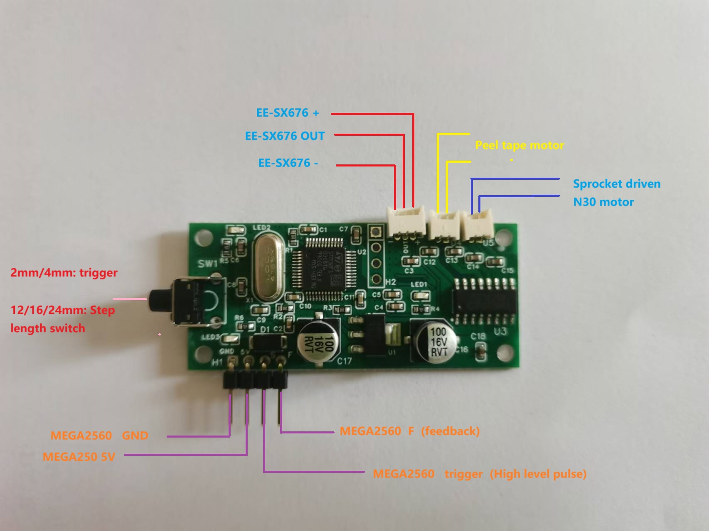
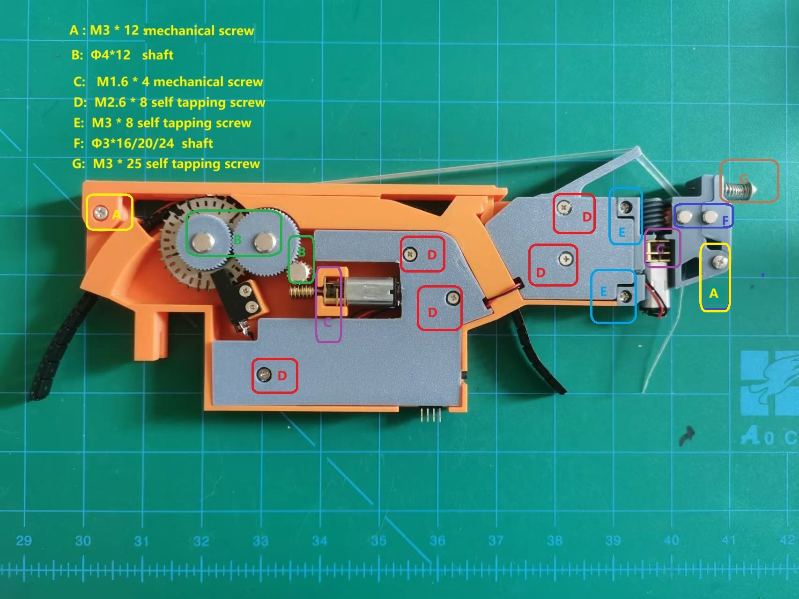
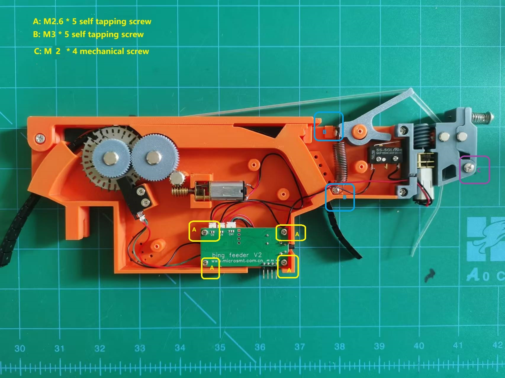
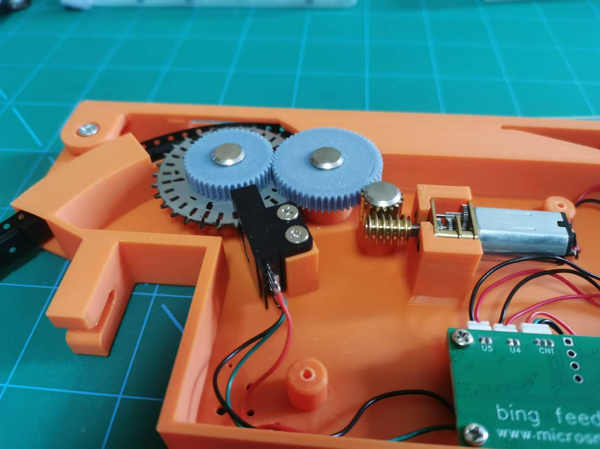

# V3 assembly and print references

> Designs and original files by [MicroSMT](https://github.com/microsmt/Bing-feeder). [Credits and local changes](../../../CREDITS.md).

[Back to V3 feeder](../README.md)

## Manuals and notes

- [V3_8mm_assembly_manual.pdf](V3_8mm_assembly_manual.pdf)
- [V3_8mm_assembly_manual_0914.pdf](V3_8mm_assembly_manual_0914.pdf)
- [V3_original-numbered-print-list.txt](V3_original-numbered-print-list.txt)
- [V3_printed-stock.txt](V3_printed-stock.txt)
- [magnetic-feeder-slot-notes.txt](magnetic-feeder-slot-notes.txt)

The print and stock lists are older notes. Check the parts on hand before relying on their quantities.

## Installation diagrams

### V2 12/16/24 mm feeder board

### V2 12/16/24 mm screw positions — sheet 1

### V2 12/16/24 mm screw positions — sheet 2

### V2 12/16/24 mm sprocket installation

### V3 8 mm feeder holder installation

