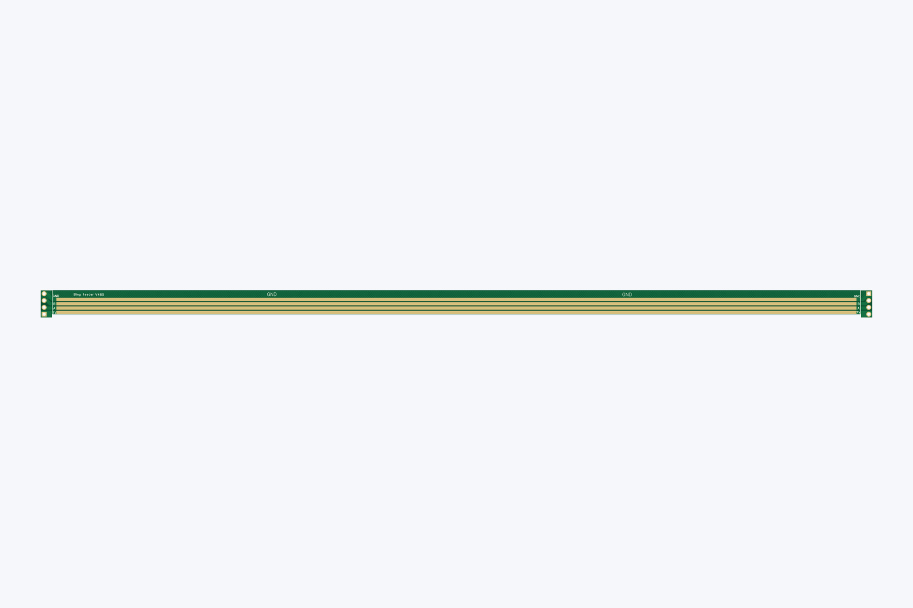
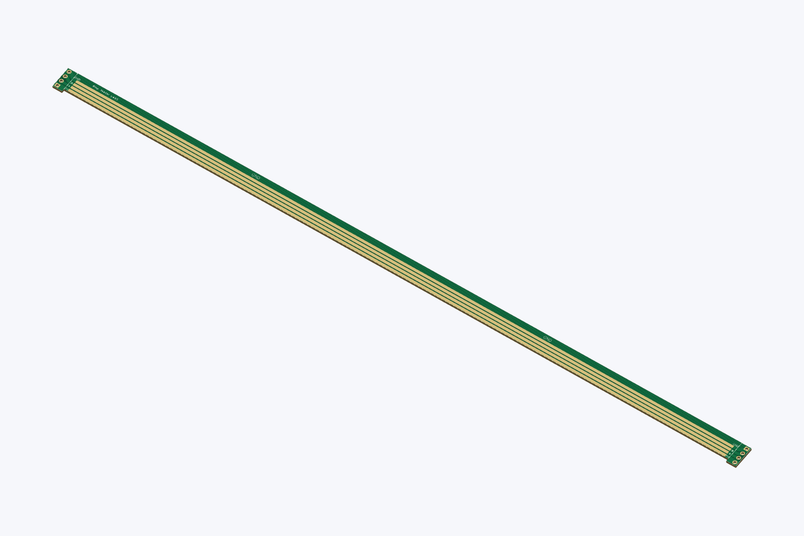
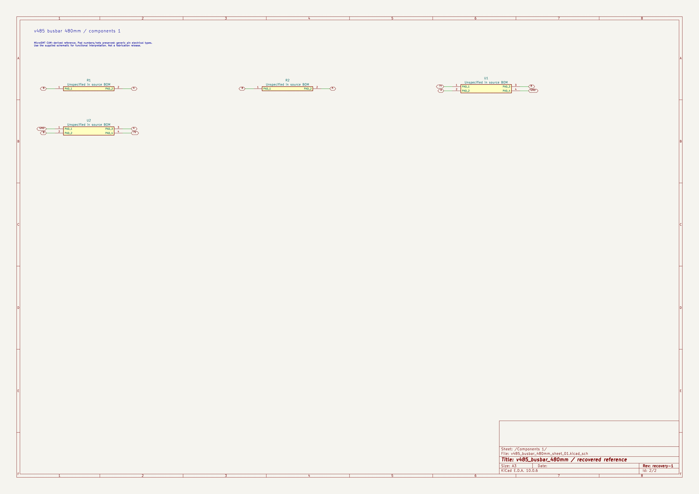
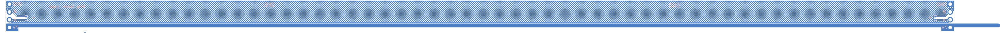

# V485 busbar — 480 mm

> Designs and original files by [MicroSMT](https://github.com/microsmt/Bing-feeder). [Credits and local changes](../../../CREDITS.md).

[Back to collection](../README.md)

The Gerber ZIP, board previews and editable KiCad files are below. Click a picture for the full-size view.

## KiCad files

Open the `.kicad_pro` file in **KiCad 10**. These projects were rebuilt from MicroSMT’s board files. Keep the whole `KiCad/` folder together so the included symbol and footprint libraries load.

The rebuilt schematics use generic pin symbols to show the original pad numbers and connections. Use MicroSMT’s supplied schematic for the actual pin functions. The KiCad rule checks still report issues; read the recovery notes before editing or ordering boards.

| Project | Open in KiCad | Supporting reports |
| --- | --- | --- |
| V485 480 mm busbar | [v485_busbar_480mm.kicad_pro](KiCad/v485_busbar_480mm.kicad_pro) | [Recovery](docs/recovery.json) · [Validation](docs/validation.json) |

[Recovery details](docs/KICAD_RECOVERY.md) · [Method and editing limits](../../../tools/kicad/RECOVERY_NOTES.md)

## Original board views

[Download Gerber ZIP](Gerber_PCB1_2026-10-09.zip)

<table>
<tr>
<td align="center"> Top</td>
<td align="center"> Bottom</td>
<td align="center"> Top-side isometric</td>
</tr>
</table>

## Assembly notes

MicroSMT specifies **two 480 mm busbars per PNP machine**: one at the front and one at the back.

These pictures were drawn from the Gerbers and drill files. The colours and 1.6 mm board thickness are just display settings, not confirmed manufacturing specifications.

## KiCad previews

These views show the rebuilt KiCad projects. The Gerber views above come from MicroSMT’s original files.

### V485 480 mm busbar

<table>
<tr>
<td align="center"> Recovered schematic</td>
<td align="center"> Recovered PCB top</td>
<td align="center"> Recovered PCB bottom</td>
</tr>
</table>

[Sheet overview](photos/kicad-v485_busbar_480mm-overview.jpg) · [Components 1](photos/kicad-v485_busbar_480mm-sheet-01.jpg)
