# V485 busbars — 180 mm

> **Original: [MicroSMT / Bing-feeder](https://github.com/microsmt/Bing-feeder).** [Credits and local changes](../../../CREDITS.md).

[Back to collection](../README.md)

Download the Gerber ZIP or click a preview to open it full size.

## Editable KiCad references

Open these projects in **KiCad 10**. They are local reconstructions of MicroSMT’s manufacturing files, with connected schematics, native PCB objects and local libraries. Keep the whole `KiCad/` folder together.

The schematics preserve source pad numbers and nets using generic passive pin symbols. They establish connectivity; use the supplied schematic for device pin functions and electrical interpretation. Existing layout-rule findings remain visible.

| Project | Open in KiCad | Supporting reports |
| --- | --- | --- |
| V485 short busbar PCB1 | [v485_busbar_180mm_pcb1.kicad_pro](KiCad/v485_busbar_180mm_pcb1.kicad_pro) | [Recovery](docs/v485_busbar_180mm_pcb1-recovery.json) · [Validation](docs/v485_busbar_180mm_pcb1-validation.json) |
| V485 short busbar PCB2 | [v485_busbar_180mm_pcb2.kicad_pro](KiCad/v485_busbar_180mm_pcb2.kicad_pro) | [Recovery](docs/v485_busbar_180mm_pcb2-recovery.json) · [Validation](docs/v485_busbar_180mm_pcb2-validation.json) |
| V485 short busbar PCB4 | [v485_busbar_180mm_pcb4.kicad_pro](KiCad/v485_busbar_180mm_pcb4.kicad_pro) | [Recovery](docs/v485_busbar_180mm_pcb4-recovery.json) · [Validation](docs/v485_busbar_180mm_pcb4-validation.json) |

[Recovery details](docs/KICAD_RECOVERY.md) · [Method and editing limits](../../../tools/kicad/RECOVERY_NOTES.md)

## Gerber previews — Gerber_PCB1_2026-10-09

[Download Gerber ZIP](Gerber_PCB1_2026-10-09.zip)

<table>
<tr>
<td align="center"><a href="photos/Gerber_PCB1_2026-10-09-top.jpg">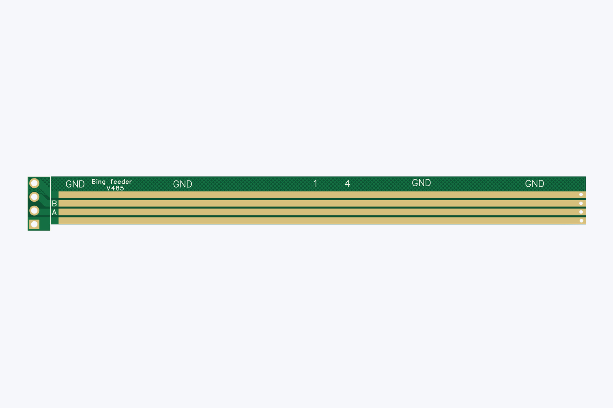</a> Top</td>
<td align="center"><a href="photos/Gerber_PCB1_2026-10-09-bottom.jpg">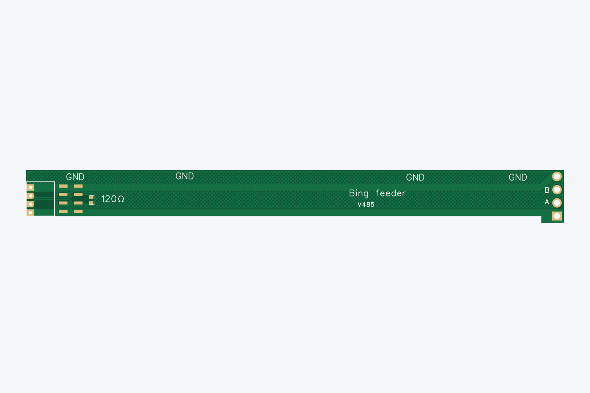</a> Bottom</td>
<td align="center"><a href="photos/Gerber_PCB1_2026-10-09-iso.jpg">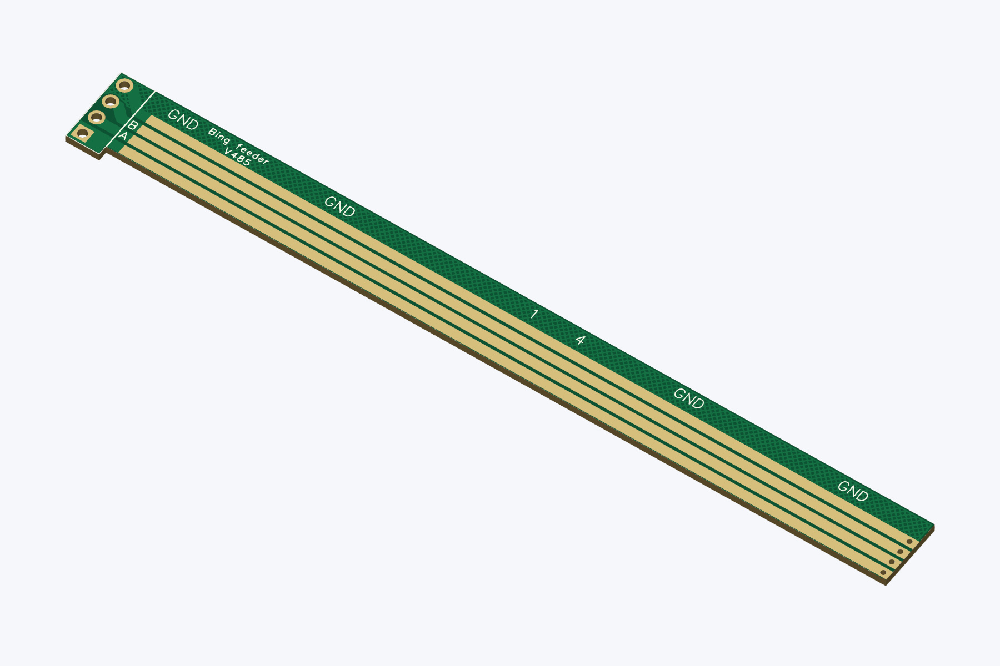</a> Top-side isometric</td>
</tr>
</table>

## Gerber previews — Gerber_PCB2_2026-10-09

[Download Gerber ZIP](Gerber_PCB2_2026-10-09.zip)

<table>
<tr>
<td align="center"><a href="photos/Gerber_PCB2_2026-10-09-top.jpg">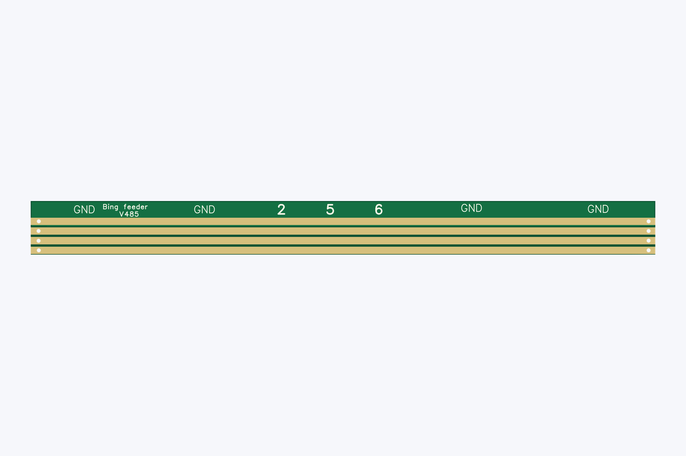</a> Top</td>
<td align="center"><a href="photos/Gerber_PCB2_2026-10-09-bottom.jpg">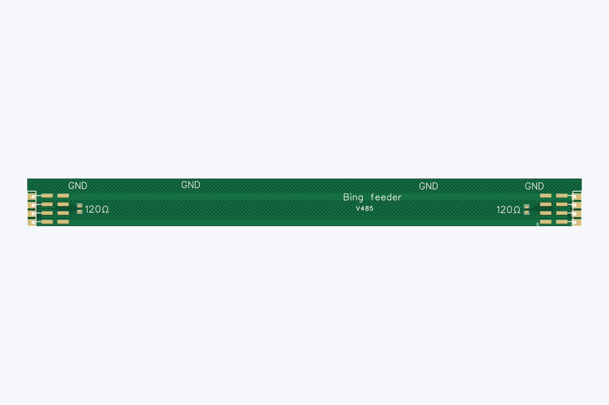</a> Bottom</td>
<td align="center"><a href="photos/Gerber_PCB2_2026-10-09-iso.jpg">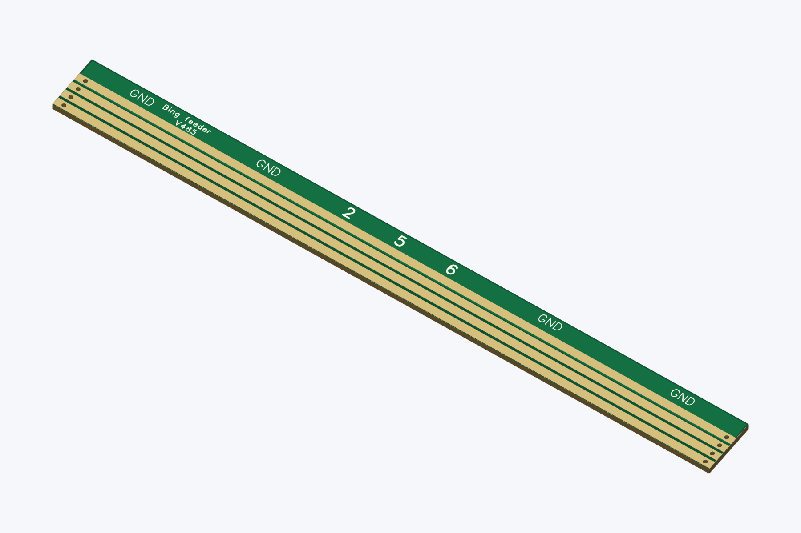</a> Top-side isometric</td>
</tr>
</table>

## Gerber previews — Gerber_PCB4_2026-10-09

[Download Gerber ZIP](Gerber_PCB4_2026-10-09.zip)

<table>
<tr>
<td align="center"><a href="photos/Gerber_PCB4_2026-10-09-top.jpg">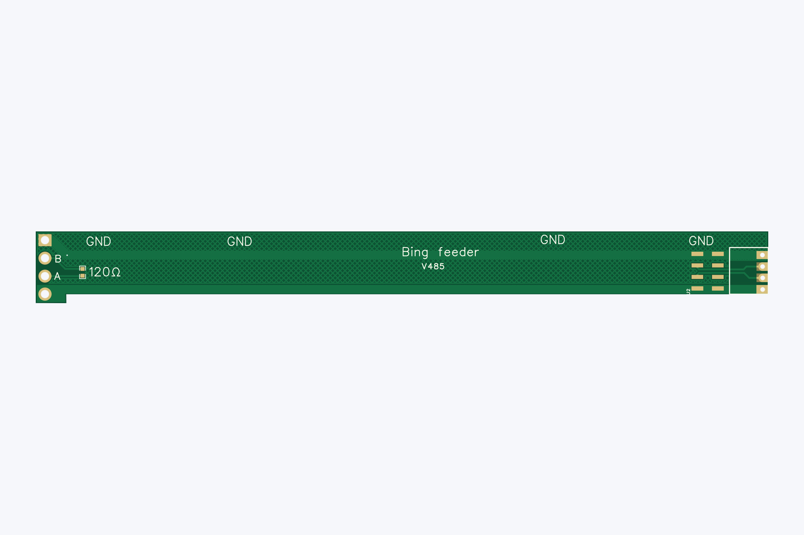</a> Top</td>
<td align="center"><a href="photos/Gerber_PCB4_2026-10-09-bottom.jpg">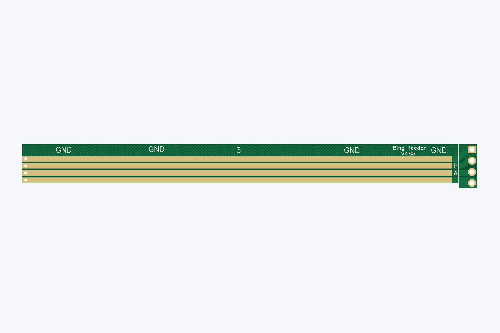</a> Bottom</td>
<td align="center"><a href="photos/Gerber_PCB4_2026-10-09-iso.jpg">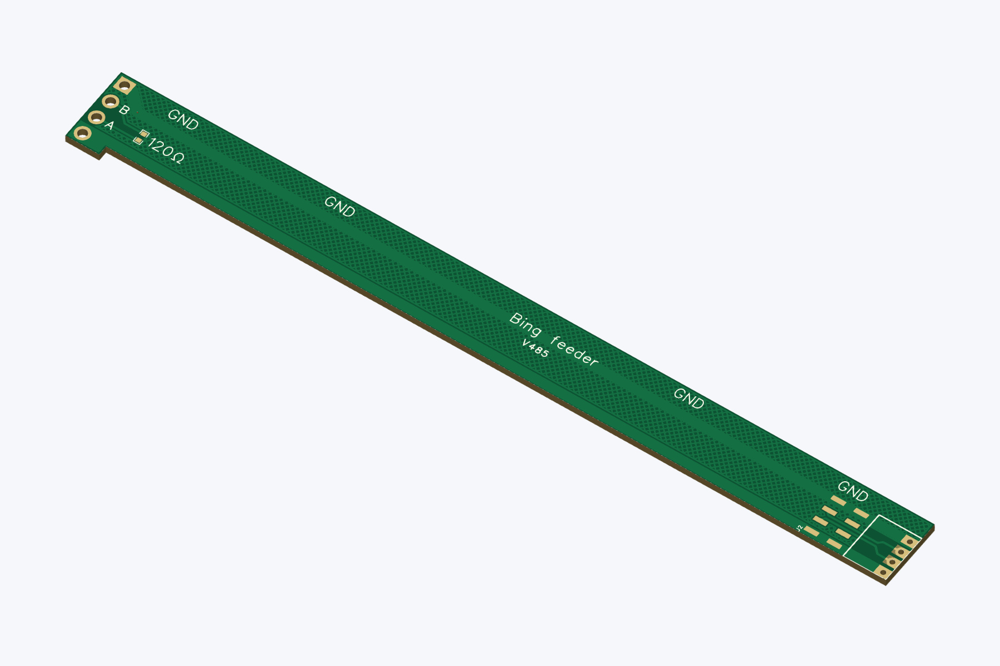</a> Top-side isometric</td>
</tr>
</table>

## Supplied notes

MicroSMT supplies 180 mm PCB busbars because the shorter sections are easier to transport. **PCB1, PCB2 and PCB4 each require two pieces.**

The previews show bare-board geometry from the supplied Gerbers and drill files. Colours and the 1.6 mm rendering thickness are illustrative.

## KiCad previews

These JPGs show the recovered editable projects. The Gerber previews above show the original manufacturing files. Click an image for full size.

### V485 short busbar PCB1

<table>
<tr>
<td align="center"><a href="photos/kicad-v485_busbar_180mm_pcb1-schematic.jpg">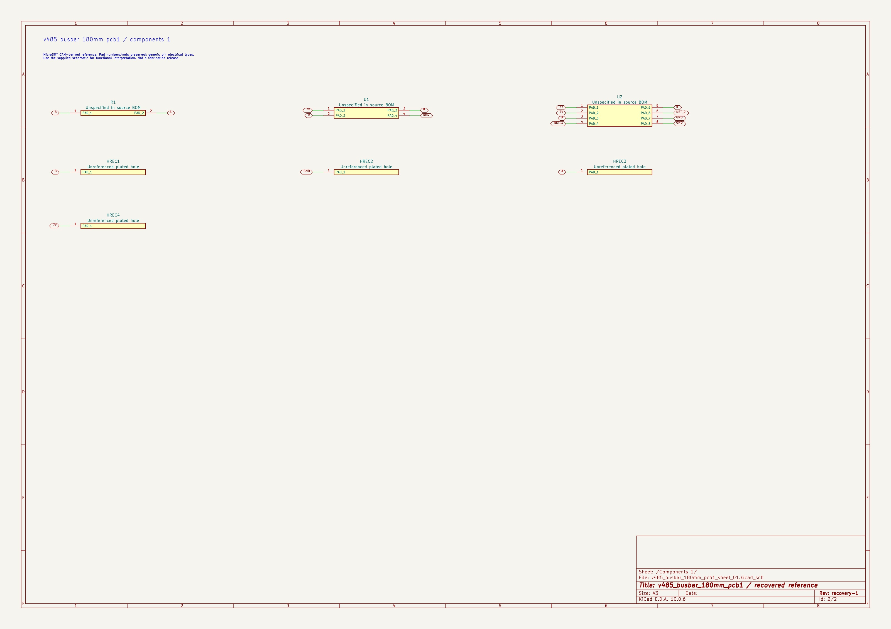</a> Recovered schematic</td>
<td align="center"><a href="photos/kicad-v485_busbar_180mm_pcb1-top.jpg">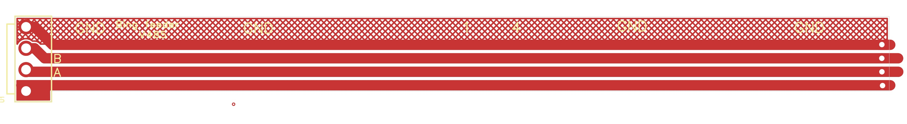</a> Recovered PCB top</td>
<td align="center"><a href="photos/kicad-v485_busbar_180mm_pcb1-bottom.jpg">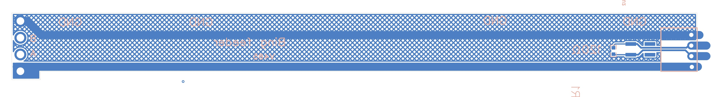</a> Recovered PCB bottom</td>
</tr>
</table>

[Sheet overview](photos/kicad-v485_busbar_180mm_pcb1-overview.jpg) · [Components 1](photos/kicad-v485_busbar_180mm_pcb1-sheet-01.jpg)

### V485 short busbar PCB2

<table>
<tr>
<td align="center"><a href="photos/kicad-v485_busbar_180mm_pcb2-schematic.jpg">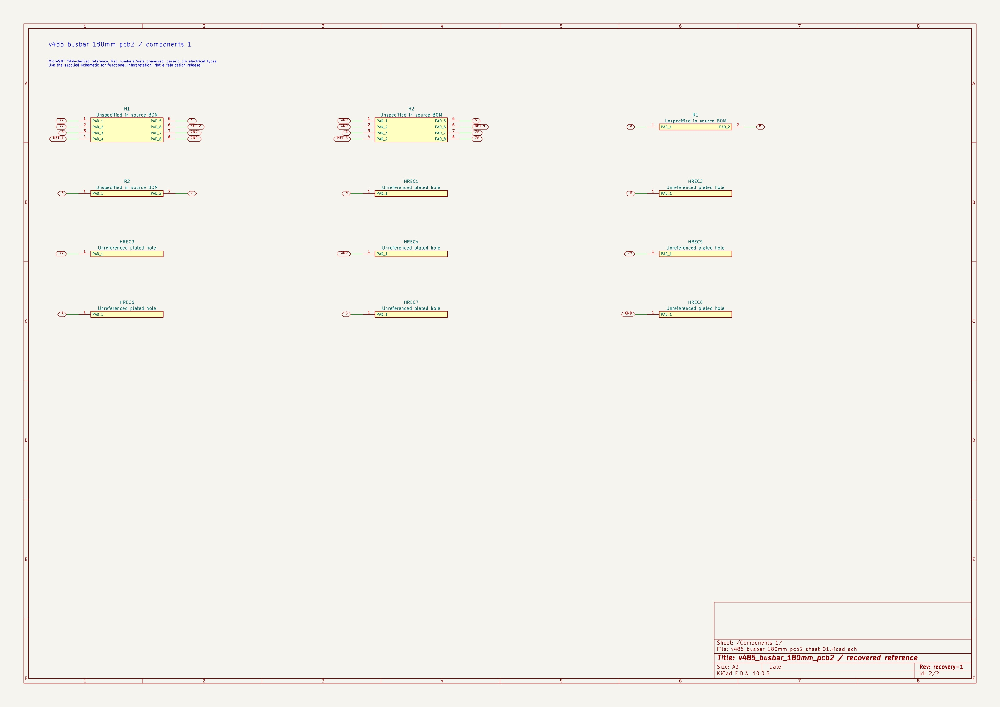</a> Recovered schematic</td>
<td align="center"><a href="photos/kicad-v485_busbar_180mm_pcb2-top.jpg">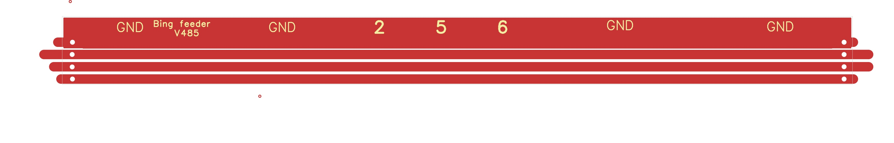</a> Recovered PCB top</td>
<td align="center"><a href="photos/kicad-v485_busbar_180mm_pcb2-bottom.jpg">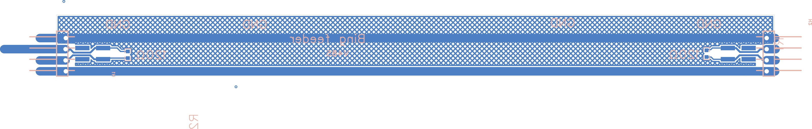</a> Recovered PCB bottom</td>
</tr>
</table>

[Sheet overview](photos/kicad-v485_busbar_180mm_pcb2-overview.jpg) · [Components 1](photos/kicad-v485_busbar_180mm_pcb2-sheet-01.jpg)

### V485 short busbar PCB4

<table>
<tr>
<td align="center"><a href="photos/kicad-v485_busbar_180mm_pcb4-schematic.jpg">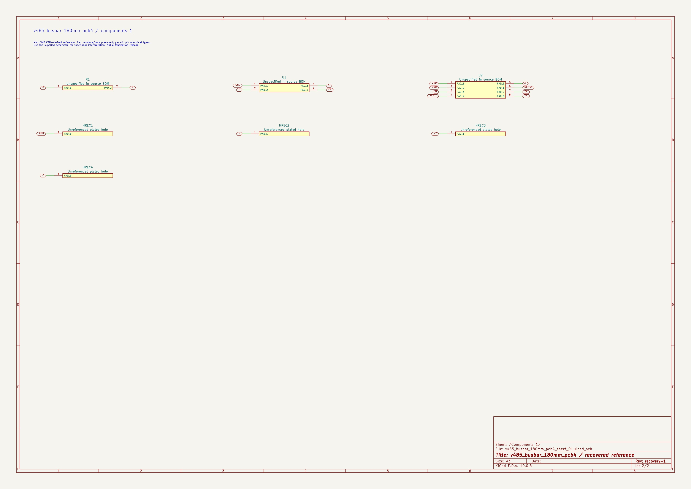</a> Recovered schematic</td>
<td align="center"><a href="photos/kicad-v485_busbar_180mm_pcb4-top.jpg">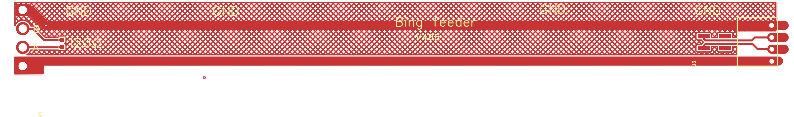</a> Recovered PCB top</td>
<td align="center"><a href="photos/kicad-v485_busbar_180mm_pcb4-bottom.jpg">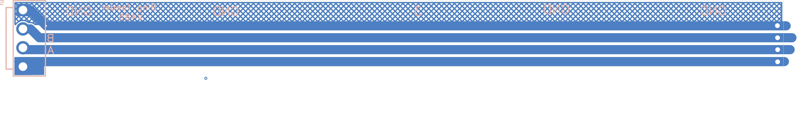</a> Recovered PCB bottom</td>
</tr>
</table>

[Sheet overview](photos/kicad-v485_busbar_180mm_pcb4-overview.jpg) · [Components 1](photos/kicad-v485_busbar_180mm_pcb4-sheet-01.jpg)
