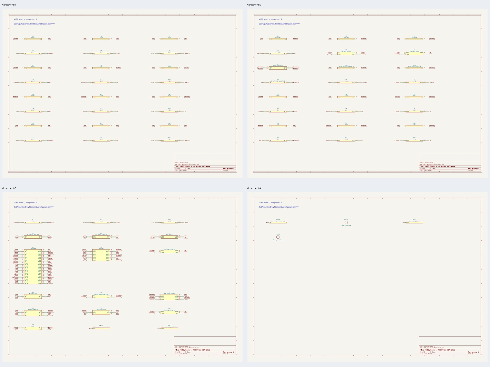
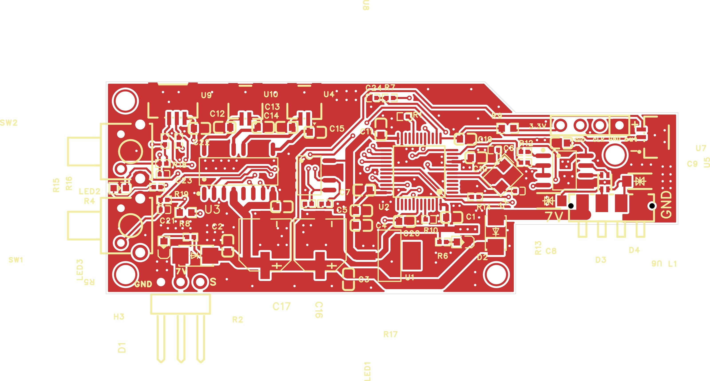
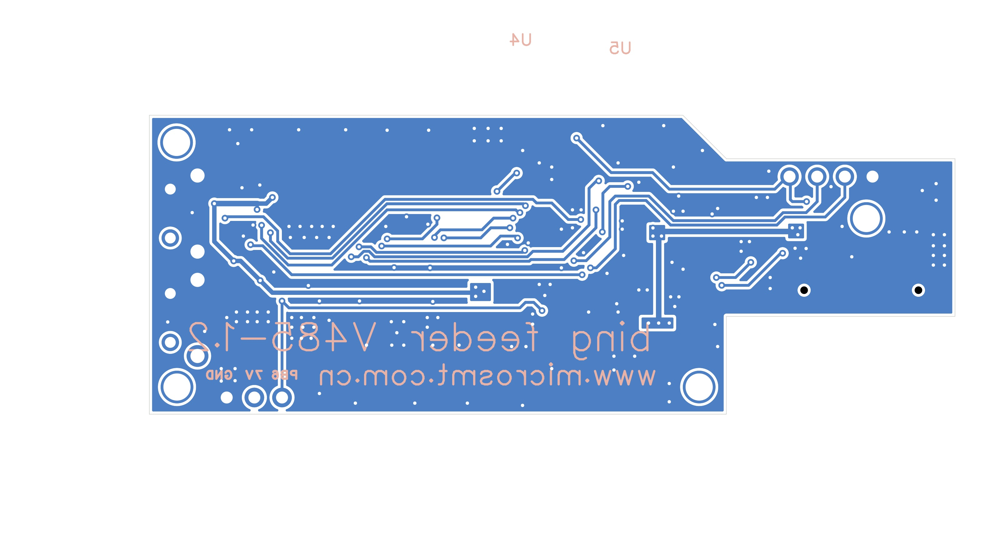

# V485 feeder PCB

> Designs and original files by [MicroSMT](https://github.com/microsmt/Bing-feeder). [Credits and local changes](../../../CREDITS.md).

[Back to collection](../README.md)

Gerbers, editable KiCad files and previews are below.

## KiCad files

Open `.kicad_pro` in **KiCad 10**. Keep the whole `KiCad/` folder together; it contains the local libraries.

The schematics show pad numbers and connections. Use the supplied schematic for pin functions. Review the reported ERC/DRC findings before making a board.

| Project | Open in KiCad | Supporting reports |
| --- | --- | --- |
| V485 feeder | [v485_feeder.kicad_pro](KiCad/v485_feeder.kicad_pro) | [Recovery](docs/recovery.json) · [Validation](docs/validation.json) |

[Recovery details](docs/KICAD_RECOVERY.md) · [Method and editing limits](../../../tools/kicad/RECOVERY_NOTES.md)

## Original board views

[Download Gerber ZIP](Gerber_PCB3_2026-10-09.zip)

<table>
<tr>
<td align="center"> Top</td>
<td align="center"> Bottom</td>
<td align="center"> Top-side isometric</td>
</tr>
</table>

## Schematics, parts lists and notes

- [BOM_Board1_PCB3_2026-10-09.xlsx](docs/BOM_Board1_PCB3_2026-10-09.xlsx)
- [SCH_schematic1_2026-10-09.pdf](docs/SCH_schematic1_2026-10-09.pdf)

Gerber previews use display colours and an assumed 1.6 mm thickness; use source data for manufacturing dimensions.

## KiCad previews

KiCad reconstruction views; source Gerber views are above.

### V485 feeder

<table>
<tr>
<td align="center"> Recovered schematic</td>
<td align="center"> Recovered PCB top</td>
<td align="center"> Recovered PCB bottom</td>
</tr>
</table>

[Sheet overview](photos/kicad-v485_feeder-overview.jpg) · [Components 1](photos/kicad-v485_feeder-sheet-01.jpg) · [Components 2](photos/kicad-v485_feeder-sheet-02.jpg) · [Components 3](photos/kicad-v485_feeder-sheet-03.jpg) · [Components 4](photos/kicad-v485_feeder-sheet-04.jpg)
