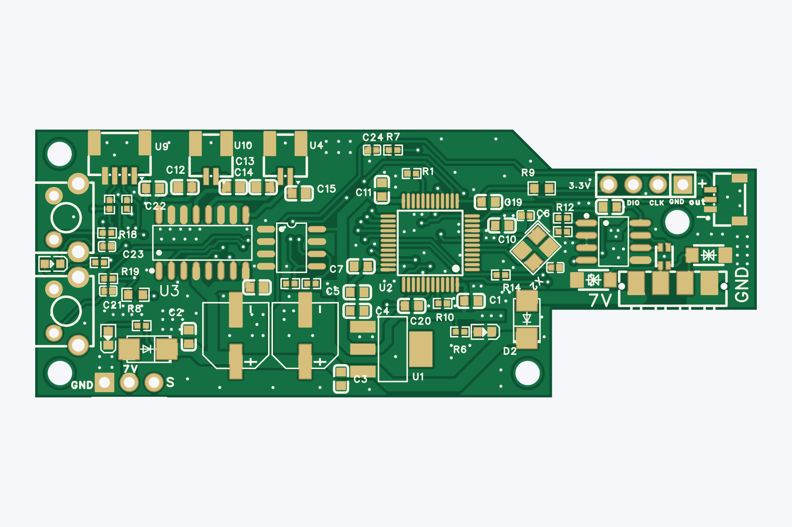
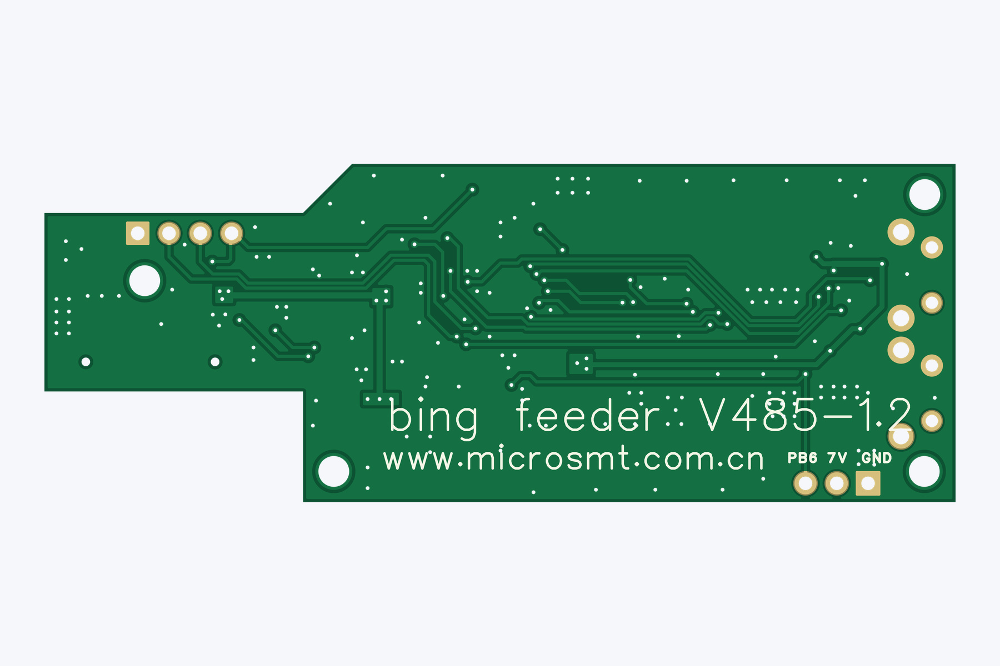
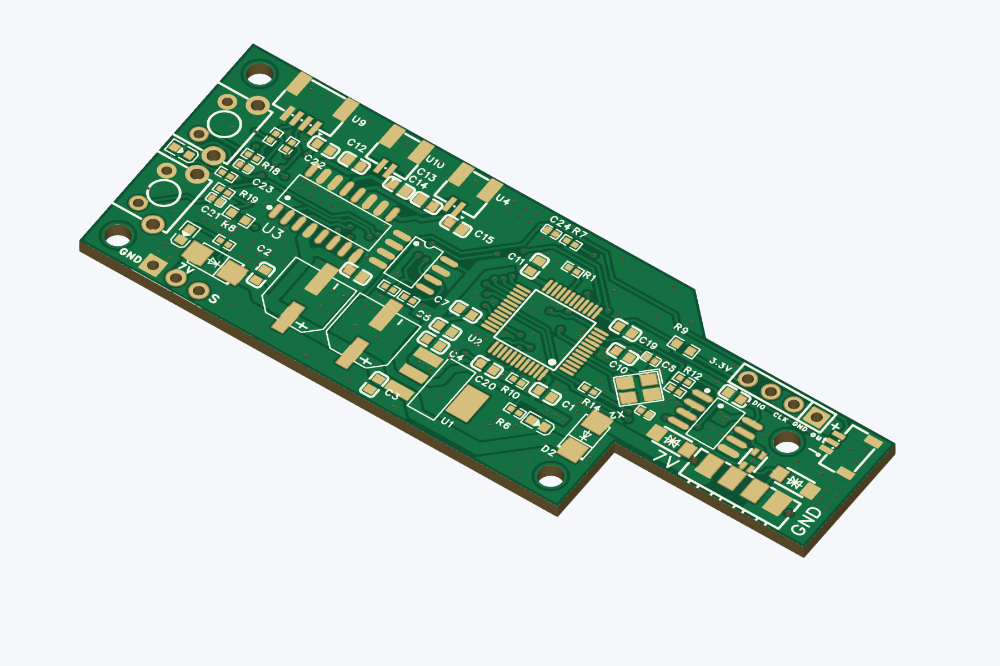

# V485 feeder PCB

> **Original: [MicroSMT / Bing-feeder](https://github.com/microsmt/Bing-feeder).** Reorganised by Gab with ChatGPT. [Credits](../../../CREDITS.md).

[Back to collection](../README.md)

Download the Gerber ZIP or click a preview to open it full size.

## Gerber_PCB3_2026-10-09

[Download Gerber ZIP](Gerber_PCB3_2026-10-09.zip)

<table>
<tr>
<td align="center"> Top</td>
<td align="center"> Bottom</td>
<td align="center"> Top-side isometric</td>
</tr>
</table>

## Schematics, BOMs and supplied notes

- [BOM_Board1_PCB3_2026-10-09.xlsx](BOM_Board1_PCB3_2026-10-09.xlsx)
- [SCH_schematic1_2026-10-09.pdf](SCH_schematic1_2026-10-09.pdf)

The previews show bare-board geometry from the supplied Gerbers and drill files. Colours and the 1.6 mm rendering thickness are illustrative.
