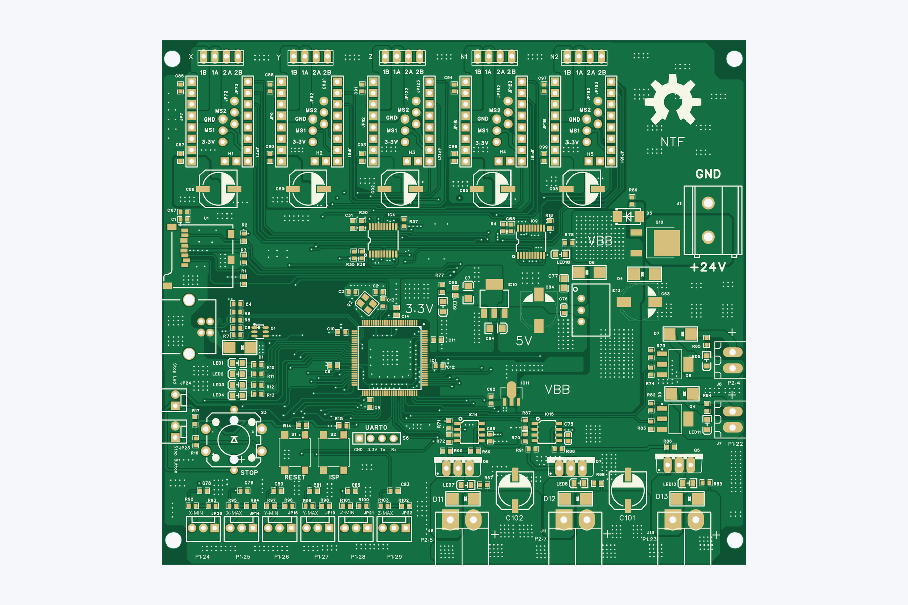
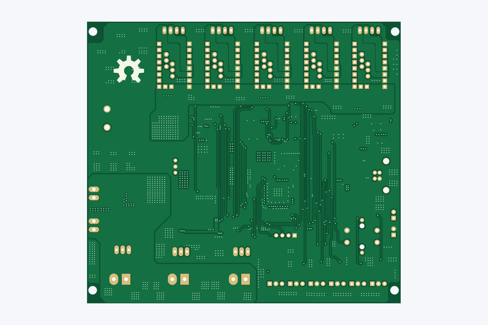

# PNPv3 motherboard PCB

> **Original source: [MicroSMT / Microsmt-PNPv3](https://github.com/microsmt/Microsmt-PNPv3).** This is Gab's independently reorganised copy, prepared with help from ChatGPT. The original MicroSMT designs remain credited to their authors. [Credits and changes](../../CREDITS.md).

[Back to collection](../README.md)

Download the Gerber ZIP or click a preview to open it full size.

## Gerber_PCB

[Download Gerber ZIP](Gerber_PCB.zip)

<table>
<tr>
<td align="center"> Top</td>
<td align="center"> Bottom</td>
<td align="center"> Top-side isometric</td>
</tr>
</table>

## Schematics, BOMs and supplied notes

- [SCH.pdf](SCH.pdf)

The previews show bare-board geometry from the supplied Gerbers and drill files. Colours and the 1.6 mm rendering thickness are illustrative.
