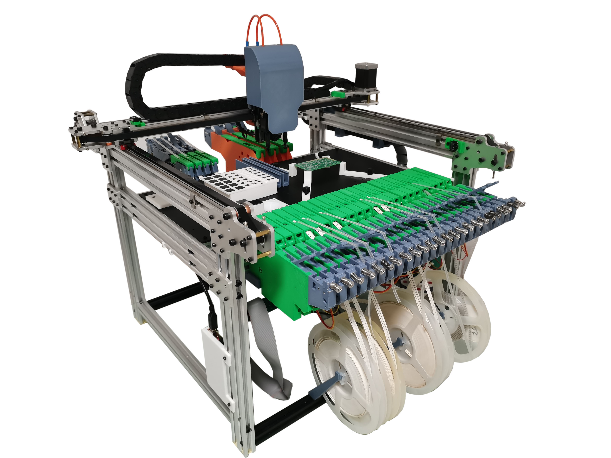
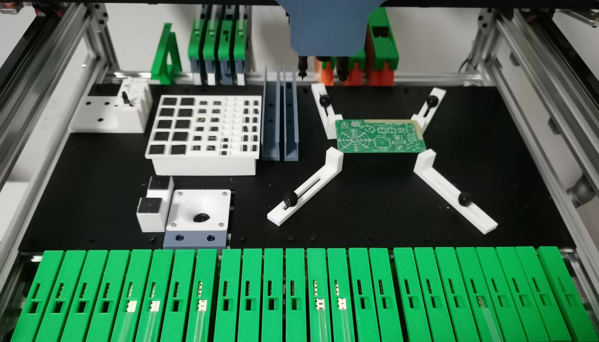
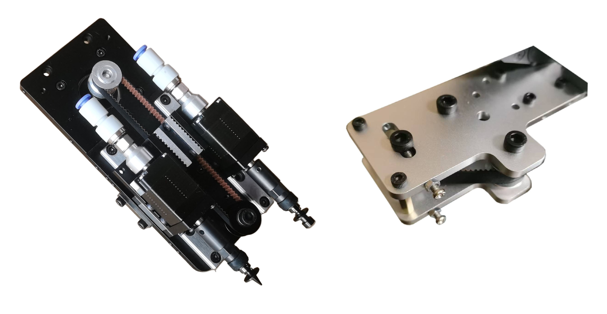
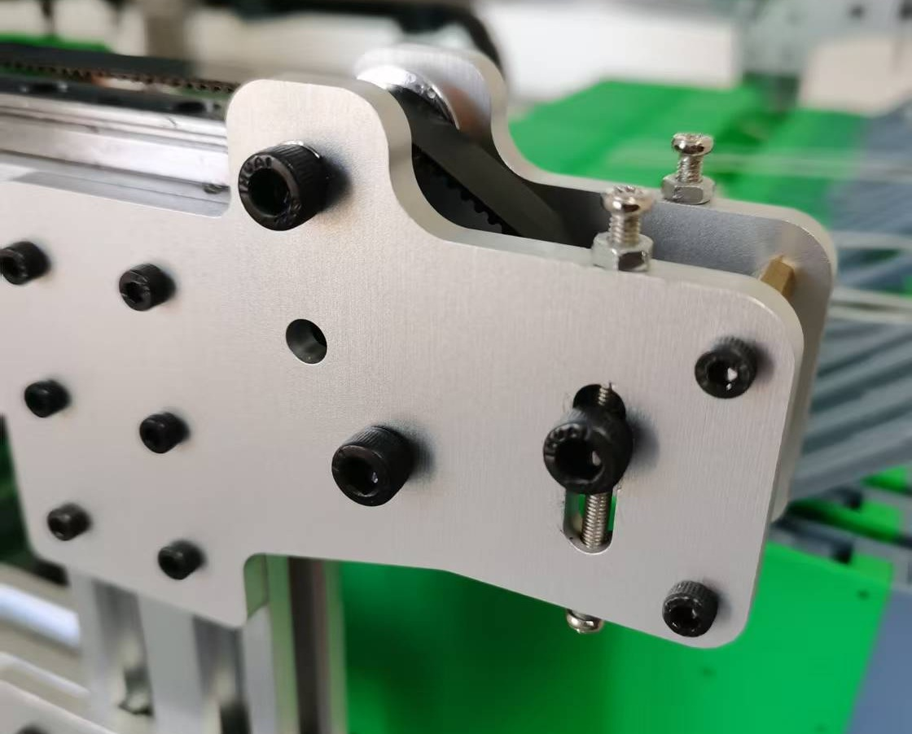

# MicroSMT PNPv3 machine

> **Original: [MicroSMT / Microsmt-PNPv3](https://github.com/microsmt/Microsmt-PNPv3).** [Credits and local changes](../CREDITS.md).

Machine parts, nozzle racks, strip feeders, motherboard files and assembly manuals.

| Browse | Contents |
| --- | --- |
| [Machine parts gallery](PNP-V3_3D_parts_2026-02-04/README.md) | 25 parts with STEP/STL links and nine previews per part |
| [CP45 nozzle rack gallery](CP45_nozzle_rack/README.md) | Left/right rack parts and clamps |
| [Strip feeder gallery](Strip_feeders/README.md) | Tape-width and bit-count variants |
| [Motherboard](PCB_motherboard/README.md) | Gerber ZIP, schematic and top/bottom/isometric previews |

## Manuals

- [Assembly Manual for Electrical  of  PNPv3 2025082801.pdf](Assembly%20Manual%20for%20Electrical%20%20of%20%20PNPv3%202025082801.pdf)
- [Assembly manual for  the frame of pnpv3 20241226.pdf](Assembly%20manual%20for%20%20the%20frame%20of%20pnpv3%2020241226.pdf)
- [Backlash Compensation and Camera Calibration.pdf](Backlash%20Compensation%20and%20Camera%20Calibration.pdf)
- [microsmt_pnpboard_v1.7_manual 20241129.pdf](microsmt_pnpboard_v1.7_manual%2020241129.pdf)

[Calibration card](Calibration%20card.png)

## Vendor introduction and support

### Get the kits  www.microsmt.com.cn
### Technical support  
https://discord.gg/qT7ZAAgspy \
https://groups.google.com/g/pnpv3-bing-feeder   

### What is MicroSMT PNPv3?
MicroSMT PNPv3 is an open-source pick-and-place machine kit designed specifically for compatibility with OpenPnP software. All the work started in 2021 and has been continuously iterated and improved ever since.

Like many classic DIY kits for OpenPnP, we continue to use a Cartesian XY design. 

 Its main  components must be CNC-machined from aluminum alloy,Relying on robust aluminum alloy components, it achieves high-speed, high-precision operation.

### Innovative tensioner
We simply added a toothless idler to the classic kit, making belt tensioning effortless. This design offers a significant cost advantage.

