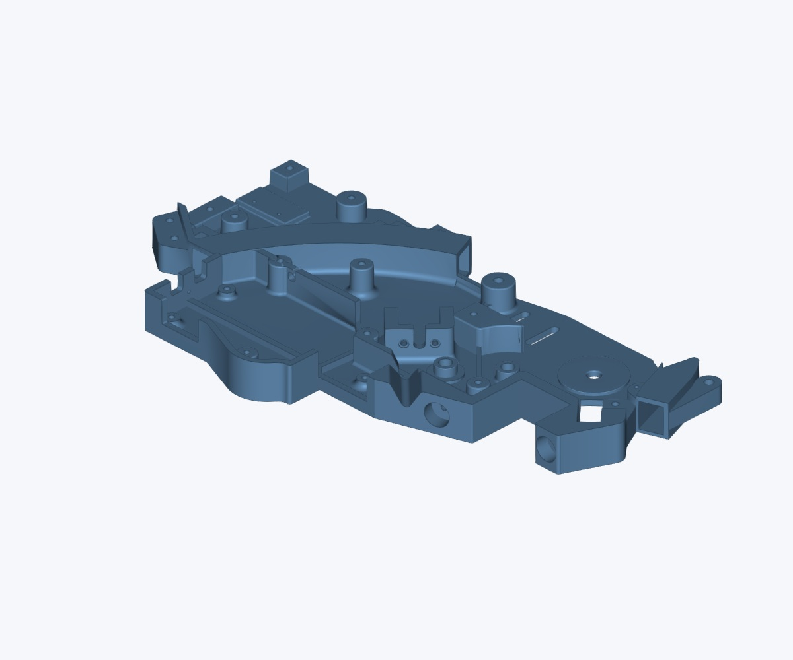
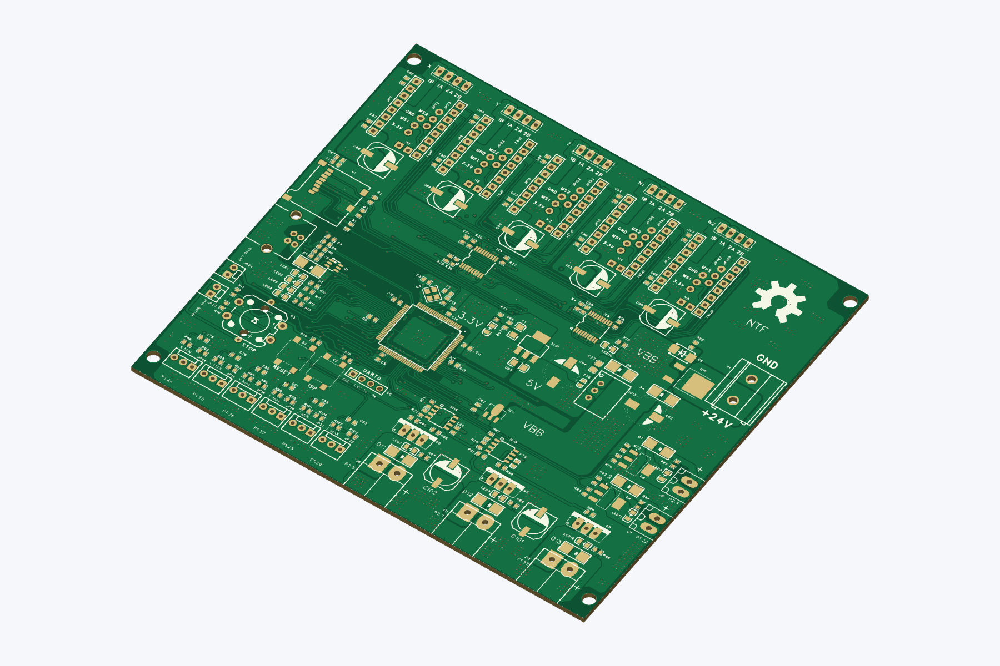

# MicroSMT PNPv3 machine and feeders

Code, CAD, board files and operating notes for this machine. The hardware designs
and original firmware are by [MicroSMT](https://github.com/microsmt).
[Credits](CREDITS.md) · [Licences](THIRD_PARTY_NOTICES.md).

## Machine software

The Dell OptiPlex runs Debian 13 and OpenPnP. OpenPnP connects directly to the
Smoothieboard and cameras, and handles motion, pickup teaching, nozzles and jobs.
The feeder host owns the separate USB–RS485 adapter and serves the dashboard at
`http://machine-hostname/`, plain HTTP port 80 without login. OpenPnP advances
feeders through TCP `127.0.0.1:5001`.

| Software | Source and instructions |
| --- | --- |
| Dashboard, feeder host and OpenPnP companion | [USB_host/](Bing-feeder/V485-feeder/USB_host/README.md) |
| Universal feeder firmware **0.1.3**, bootloader and serial tools | [CODE_feeder/](Bing-feeder/V485-feeder/CODE_feeder/README.md) |
| Machine configuration and calibration | [Machine notes](Microsmt-PNPv3/docs/README.md) |
| EEPROM layout, saved settings and text/quantity limits | [EEPROM.md](EEPROM.md) |
| Remaining work | [TODO.md](TODO.md) |

The dashboard covers feeder state/errors, reel stock, motor/switch settings,
input tests and firmware updates. It also edits OpenPnP parts/packages and checks
remaining job stock. Tip compatibility is selected through packages; physical
nozzle setup stays in OpenPnP.

Build the feeder application with `pio run -e v485` from `CODE_feeder`.
It creates the dashboard firmware bundle automatically. Deploy the bundle and
select **Update** or **Update all outdated**, using the installed bootloader.
See the guides above for installation and operating details.

## Parts and boards

| Collection | Contents |
| --- | --- |
| [V485 feeders](Bing-feeder/V485-feeder/README.md) | 8/12/16/24 mm parts, PCBs and firmware |
| [V485 controller](Bing-feeder/V485-Feeder%20Controller/README.md) | ESP32-C3 controller and RS485 busbars |
| [V3 feeders](Bing-feeder/V3-feeder/README.md) | Parts, PCBs, source and assembly references |
| [V3 controller](Bing-feeder/V3-Feeder%20Controller/README.md) | Mega2560 sketch, controller PCB and busbars |
| [PNPv3 machine](Microsmt-PNPv3/README.md) | Frame parts, nozzle rack, strip feeders, motherboard and manuals |
| [KiCad projects](tools/kicad/README.md) | Editable board references, source comparisons and rebuild tools |
| [Missing V485 parts](V485-MISSING-PARTS.md) | Missing files and questions for the vendor |
| [STM32 source builds](Bing-feeder/STM32-BUILD.txt) | V485 build and V3 project requirements |

STL files are for printing; STEP files are for editing. Board folders contain
Gerbers, `KiCad/`, `docs/` and `photos/`. Keep each KiCad folder together for its
local libraries. Read the [recovery notes](tools/kicad/RECOVERY_NOTES.md) before
changing recovered copper or ordering boards.

View galleries on GitHub or with **Ctrl+Shift+V** in VS Code. Keep the photos
beside their READMEs. Machine profiles, stock databases, credentials and generated
builds remain outside Git. Local changes were prepared with ChatGPT assistance;
upstream attribution and licence notices remain in the repository.
